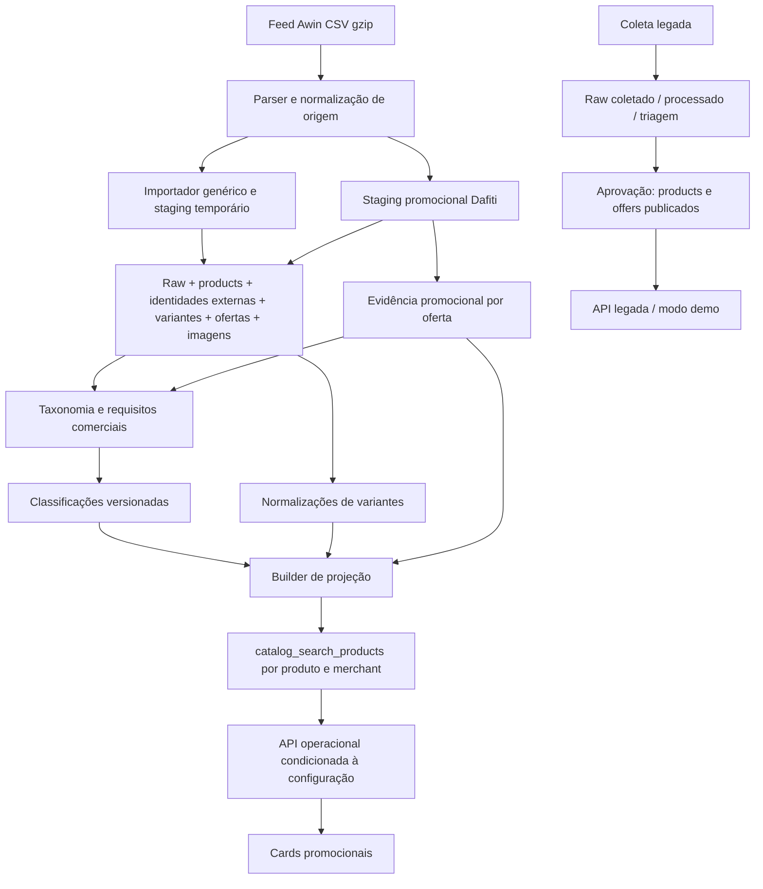
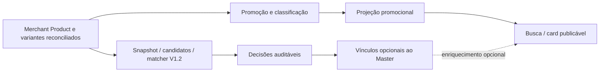

# Product Identity V1.2 — Integração operacional V1

Data: 2026-09-29. Base inspecionada: `a6b59acb3143ef2b0f2fff671db1a5acd776b78a`, branch `codespace-preview`.

**Status: proposta de arquitetura. Nenhuma persistência operacional implementada.**
O Passo A foi concluído com sincronização externa confirmada pelo usuário. Esta continuação não executou fetch, pull, checkout, reset, merge ou rebase.

## 1. Conclusão e regra de produto

O UpPulse encontra e apresenta oportunidades promocionais: produto, preço atual, preço anterior, desconto e alternativas relevantes. Comparação entre lojas é um benefício adicional.

**Um produto promocional válido de uma única loja continua PUBLICÁVEL e projetável para busca.** Ausência de candidato, REVIEW, NO_MATCH ou indisponibilidade do serviço de identidade não muda sua elegibilidade, não gera quarentena e não remove o produto do catálogo.

Integrar Product Identity como processamento independente **depois da reconciliação dos registros de origem**, em paralelo à classificação promocional. Aplicar seus vínculos apenas como enriquecimento opcional da leitura. Preservar IDs, ofertas e atributos comerciais de cada origem.

O esquema já comporta Merchant Product, variante de origem e oferta. Falta uma identidade Master compartilhada, com decisões e vínculos auditáveis. A proposta mínima reutiliza essas entidades e adiciona uma camada pequena de identidade; não cria outro cadastro de merchants, produtos de origem ou ofertas.

## 2. Escopo e evidências da inspeção

Análise estática do código, migrations, contratos e testes. Não houve consulta ao banco, leitura de credenciais, execução de feed, reprojeção ou servidor. A presença de uma migration no repositório não comprova sua aplicação em qualquer ambiente. Contagens históricas em scripts são invariantes de lotes anteriores, não contagens atuais verificadas.

Referências relativas à raiz deste repositório:

| Responsabilidade | Código/contrato inspecionado |
| --- | --- |
| Esquema principal | [shared/schema.ts](../schema.ts) |
| Origem, variantes e ofertas | [0006_commerce_staging_model.sql](../../migrations/0006_commerce_staging_model.sql) |
| Evidência promocional | [0007_offer_promotion_evidence.sql](../../migrations/0007_offer_promotion_evidence.sql) |
| Classificações e normalizações | [0008_operational_catalog.sql](../../migrations/0008_operational_catalog.sql) |
| Índices de leitura operacional | [0009_catalog_preview_performance.sql](../../migrations/0009_catalog_preview_performance.sql) |
| Projeção de busca | [0010_catalog_search_projection.sql](../../migrations/0010_catalog_search_projection.sql) |
| Feed genérico | [awin-import.ts](../../scripts/awin-import.ts), [types.ts](../../server/integrations/awin/types.ts), [csv.ts](../../server/integrations/awin/csv.ts), [input.ts](../../server/integrations/awin/input.ts), [normalize.ts](../../server/integrations/awin/normalize.ts), [repository.ts](../../server/integrations/awin/repository.ts) |
| Staging promocional específico | [awin-dafiti-staging.ts](../../scripts/awin-dafiti-staging.ts), [dafitiStaging.ts](../../server/integrations/awin/dafitiStaging.ts), [dafitiAudit.ts](../../server/integrations/awin/dafitiAudit.ts) |
| Triagem Awin | [curation.ts](../../server/integrations/awin/curation.ts), [dafitiCuration.ts](../../server/integrations/awin/dafitiCuration.ts), [productTaxonomy.ts](../../server/integrations/awin/productTaxonomy.ts) |
| Persistência editorial | [awin-dafiti-catalog-persist.ts](../../scripts/awin-dafiti-catalog-persist.ts), [catalogPersistence.ts](../../server/integrations/awin/catalogPersistence.ts), [operationalCatalog.ts](../../server/integrations/awin/operationalCatalog.ts) |
| Construção e leitura da busca | [builder.ts](../../server/catalogSearchProjection/builder.ts), [repository.ts](../../server/catalogSearchProjection/repository.ts), [catalog-search-projection-persist.ts](../../scripts/catalog-search-projection-persist.ts) |
| Preview e catálogo público | [catalogPreview/repository.ts](../../server/catalogPreview/repository.ts), [publicCatalog/operational.ts](../../server/publicCatalog/operational.ts), [publicCatalog/policy.ts](../../server/publicCatalog/policy.ts), [routes.ts](../../server/routes.ts) |
| UI | [CatalogV2.tsx](../../client/src/pages/CatalogV2.tsx), [ProductGrid.tsx](../../client/src/components/ProductGrid.tsx), [App.tsx](../../client/src/App.tsx) |
| Identidade atual | [parser.ts](parser.ts), [matcher.ts](matcher.ts), [VALIDATION-V1.2.md](validation/VALIDATION-V1.2.md), [auditoria offline](../../scripts/product-identity-offline-evaluation.ts) |

## 3. Arquitetura e fluxo real atuais

### 3.1 Coleta e staging Awin

Não há uma única cadeia automática que execute todos os passos. Existem scripts administrativos distintos e dois caminhos de importação:

1. `awin-import.ts`: abre CSV gzip, usa `parseAwinCsv` e `normalizeAwinItem`. O modo padrão é dry-run; staging exige confirmação e conexão própria. `PostgresAwinRepository.import` usa uma tabela temporária `awin_import_stage`, reconcilia por hashes e grava entidades na mesma transação. Não executado nesta missão.
2. `awin-dafiti-staging.ts` / `DafitiStagingRepository`: caminho específico que filtra promoção confirmada, categoria, estoque, marca, imagens, URLs e identificadores. Também grava `offer_promotion_evidence`. Não é equivalente ao importador genérico.

`normalizeAwinItem` cria:

- `productKey`: hash de provider + merchant + parent ID; na ausência de parent, usa URL de página normalizada; depois, descritor de marca/nome/modelo.
- `variantKey`: inclui a chave do produto e GTIN válido ou identificador de origem e atributos disponíveis.
- `offerKey`: provider + merchant + ID comercial da origem.
- Envelope raw com `identityHash`, `contentHash`, feed e payload.

Essas chaves são de **reconciliação na origem**, não identidade global. `identityMethod`, `external_product_key` e `identitySufficient` não significam match entre merchants.

O importador genérico cria `products` como `draft`, identidades como `staging/active=false`, variantes inativas e ofertas `paused/active=false`. Seus upserts preservam determinados estados existentes. O staging Dafiti também usa esses estados e reafirma inatividade nos upserts de variantes/ofertas.

`commerce_raw_feed_items` recebe o payload e hashes, mas é atualizado por upsert: não é um histórico imutável de todos os feeds. A ordem física das gravações não é raw persistido → produto; o staging temporário é processado e o raw é gravado junto das entidades.

### 3.2 Promoção, classificação e normalização

- `offer_promotion_evidence` registra status, tipo, preço anterior, preço atual, desconto, fonte e data por oferta/fonte. O writer localizado é `DafitiStagingRepository`, com fonte `AWIN_DAFITI_FEED`. `PostgresAwinRepository` não grava essa tabela.
- `classifyPromotion` em `curation.ts` oferece classificação comercial genérica; a existência dessa função não comprova persistência dessa evidência por todos os importadores. A curação HTTP Awin está explicitamente desabilitada nesse módulo.
- `awin-dafiti-catalog-persist.ts` lê produtos, identidades, variantes, ofertas, evidências, imagens e raw. Produz classificação taxonômica e elegibilidade comercial; grava classificações e, no modo completo, normalizações.
- `identitySufficient` nesse script verifica chaves externas de produto/variante/oferta. **Não substituir esse requisito por `masterDecision === AUTO_MATCH`.**
- `validatePromotion` verifica ordem dos preços, moeda BRL e consistência matemática do desconto; `auditAffiliateUrl` verifica URL HTTP(S).
- `classifyCatalogEligibility` considera taxonomia e requisitos comerciais. `mapEligibilityToOperationalState` mapeia para `CATALOG_ELIGIBLE`, `QUARANTINED` ou `OUT_OF_SCOPE`.
- `product_catalog_classifications` e `product_variant_normalizations` são históricos protegidos por triggers contra UPDATE/DELETE na migration 0008. Os writers recusam conteúdo divergente para a mesma entidade/versão.
- Na cópia de homologação da Missão 4C, as versões atuais são `uppulse-taxonomy-v4-contextual` e `uppulse-normalizer-v3-uppulse-colors-v3-2026-10-06`. O histórico v1/v2/v3 permanece append-only. A seleção v4 exige cobertura da nova classificação nos fornecedores antes de ativar a projeção. O modo `--classification-only` não grava normalizações nem altera visibilidade.
- O modo completo contém fechamentos específicos do lote Dafiti, incluindo 74.968 variantes. Não é um orquestrador universal pronto para novos marketplaces.

### 3.3 Projeção, API e UI

`buildCatalogSearchProjection` recebe `ProjectionSourceRow[]` e agrupa por `(productId, merchantId)`. Para cada grupo elegível:

- escolhe oferta `PROMOTION_CONFIRMED`, em estoque, preço atual positivo e anterior maior;
- ordena candidatas por maior desconto, menor preço e ID como desempate;
- exige marca; ausência de imagem é contabilizada, mas não rejeitada diretamente pelo builder;
- agrega tamanhos/cores com normalização segura e atividades do grupo;
- registra versões, snapshot e timestamps.

`catalog-search-projection-persist.ts` seleciona versões explícitas de classificação/normalização, faz joins com evidências e raw e persiste a projeção em transação. Exige merchant, contagem esperada, versões, snapshot e confirmação. `removeStaleMerchantProjection` remove linhas fora do conjunto recebido para aquele merchant. Nenhum desses passos foi executado.

A projeção é SQL próprio, com tipos TypeScript no builder; não há declaração `catalogSearchProducts` em `shared/schema.ts`. Não tratar o schema Drizzle como inventário completo de tabelas.

`PgCatalogSearchProjectionRepository` implementa listagem, contagem, facetas, detalhe e acesso à oferta representativa. A leitura pública não consulta raw nem executa matcher. A busca quebra o texto em termos e aplica `LIKE` a nome + marca + merchant, com normalização de caixa/acentos e AND entre termos. Não há busca semântica ou resolução de Master.

`server/routes.ts` registra handlers operacionais antes dos handlers legados em `/api/products`, `/api/products/:id` e `/api/click/:offerId`. O modo operacional depende de `UPPULSE_PUBLIC_CATALOG_SOURCE`, `UPPULSE_PUBLIC_CATALOG_APPROVED` e configuração de conexão. Nesse modo:

- listagem filtra `CATALOG_ELIGIBLE` e disponibilidade;
- resposta declara `catalogStatus: published` a partir da projeção, sem atualizar `products.catalog_status`;
- listagem devolve `offersCount: 1` e `bestOffer` representativa;
- detalhe procura o mesmo `product_id`; não expande por identidade cross-merchant;
- erro de leitura devolve 503;
- `/catalogo` e `/catalogo-v2` usam `CatalogV2`, que consome a API e apresenta cards promocionais, filtros, preço anterior e atual.

O preview também usa a projeção, mas seu repository contém filtro fixo Dafiti (`17697`). A listagem pública operacional não contém essa restrição fixa.

### 3.4 Caminho legado coexistente

`server/jobs/collect.ts`, `collectCollections.ts` e os módulos de `server/curationSources/` atendem coleta/execução de fontes. O caminho legado usa `collection_batches`, `raw_collected_items`, `processed_items`, `triage_queue` e `curation_actions`, via `server/storage.ts`. Aprovação individual/em lote em `server/routes.ts` cria produto publicado, oferta e imagem e registra a ação de curadoria.

Esse caminho conserva dependências Mercado Livre em serviços/adaptadores e no marketplace padrão. Não passa automaticamente pelas tabelas de evidência, classificação e projeção Awin. Os handlers legados consultam `products.catalog_status='published'`. Não assumir que todos os produtos históricos possuem `external_product_identities` ou `product_variants`.

As setas expressam dependências de dados, não um scheduler único comprovado.

## 4. Conceitos existentes e reuso

Todos os IDs abaixo são PK `id` em `varchar(36)` salvo indicação contrária.

| Conceito existente | Papel preservado e integridade relevante |
| --- | --- |
| `commerce_providers` | Rede/adaptador de origem; unique `code` |
| `commerce_merchants` | Merchant no provider; FK provider, unique `(provider_id, external_merchant_id)` |
| `commerce_feeds` | Feed da origem; FKs provider/merchant, unique `(provider_id, external_feed_id)` |
| `products` | Registro comercial/editorial atual; slug unique, FKs opcionais marca/categoria; importação Awin cria registros por chave de origem |
| `external_product_identities` | Âncora do Merchant Product; FKs product/provider/merchant/feed, unique `(provider_id, merchant_id, external_product_key)` |
| `product_variants` | Variantes de origem; FKs product/provider/merchant, unique `(provider_id, merchant_id, external_variant_key)`; atributos, tamanho, cor e identificadores |
| `offers` | Ocorrência comercial; FKs product/variant/provider/merchant/marketplace conforme origem; unique `(provider_id, merchant_id, external_offer_key)`; preço, URL, disponibilidade e datas |
| `offer_promotion_evidence` | Evidência da oferta; FK offer/feed, unique `(offer_id, evidence_source)`, índice feed/data; não é evidência de identidade |
| `product_catalog_classifications` | Taxonomia/estado editorial por produto; unique `(product_id, classifier_version)`, índices produto/data, estado/versão e merchant/data |
| `product_variant_normalizations` | Normalização de origem; unique `(variant_id, normalizer_version)`, índice variante/data |
| `product_images`, `product_colors`, `brands`, `categories` | Imagens e atributos existentes; manter origem e confiança, sem copiar indiscriminadamente para outro produto |
| `catalog_search_products` | Projeção reconstruível, FKs product/provider/merchant/representative_offer; unique `(product_id, merchant_id)` |
| `marketplaces` | Compatibilidade do catálogo legado; não é sinônimo automático de provider ou merchant |

O schema permite várias identidades externas apontarem para `products.id`; porém os writers atuais não promovem `products` a Master global. Seu título, cor, publicação, classificação por produto/versão e relacionamentos existentes ainda carregam semântica de origem.

**Merchant Product proposto = `external_product_identities` + seu `products` atual.** Não criar tabela `merchant_products` duplicada. Uma identidade externa é a âncora de origem; uma linha `products` não será fundida, reatribuída ou apagada ao reconhecer outro merchant.

## 5. Gaps e riscos constatados no código

1. Não existe Master persistente, associação cross-merchant nem histórico de decisões V1.2. `masterIdentityKey` é assinatura de evidência; não serve como PK, unique global ou prova de identidade.
2. A auditoria offline seleciona apenas produtos elegíveis/disponíveis de dois merchants pelo nome. Usa marca igual, Dice de trigramas, limiar 0,55 e topK 5 para não exatos; exatos mantêm todos os pares. Isso é amostragem/candidatura limitada, não serviço operacional multi-marketplace nem prova de cobertura.
3. Raw e evidência promocional são atualizados por upsert. Reprocessamento de identidade exige capturar inputs usados, hashes e versões; um FK para raw mutável é insuficiente.
4. Há mistura de identidade de origem, elegibilidade, estado editorial e exposição pública. Não adicionar mais um significado ao campo `publication_state` nem usar `QUARANTINED` para REVIEW de identidade.
5. `isPublicOfferEligible` define inclusive idade máxima de três dias, mas não é chamado pelos handlers operacionais inspecionados. `transitionPublication` também não é a máquina de estados persistida desse caminho. Não afirmar que essas políticas já protegem toda leitura.
6. A projeção usa joins raw por merchant + merchant_product_id e evidência por offer. Múltiplos feeds/evidence sources podem multiplicar linhas; agregação não prova consistência entre snapshots. O próximo adapter de identidade precisa de seleção explícita e determinística de evidência.
7. O upsert da projeção compara um subconjunto de campos no `WHERE IS DISTINCT FROM`; mudanças somente em certas normalizações, taxonomia, versões ou timestamps podem não provocar atualização. Identidade não deve depender desse upsert como histórico completo.
8. Tamanhos/cores da projeção são agregados do grupo e podem não pertencer à oferta representativa. Não usar a projeção para comprovar igualdade de SKU ou preço de cada tamanho.
9. Consultas administrativas resolvem alguns merchants apenas por `external_merchant_id`, embora a unicidade real seja por provider. Extensões devem usar o ID interno ou provider + ID externo.
10. O staging Dafiti não grava todos os campos GTIN/EAN que o importador genérico suporta. Ausência na tabela não prova ausência no feed. Não inventar GTIN, MPN ou sistema de tamanho.
11. A unicidade de classificações é produto + versão, não produto + merchant + versão. Reapontar vários Merchant Products ao mesmo `products.id` introduziria colisões e mistura editorial.
12. `product_variants` não tem FK direta para a identidade externa; a relação depende de product/provider/merchant. Ambiguidade nessa associação deve impedir enriquecimento automático, preservando publicação independente.

Esses pontos são riscos e pré-condições futuras, não mudanças executadas nesta missão.

## 6. Arquitetura proposta e ponto exato de integração

### 6.1 Contrato e execução

Criar futuramente um serviço neutro, por exemplo `server/productIdentity/`, que consuma registros já reconciliados e snapshots da origem através de adapters. `shared/product-identity` continua puro.

Entrada primária: Merchant Products de `external_product_identities` + `products`, variantes de `product_variants` e evidência de origem selecionada. Normalizações existentes são auxiliares; sua ausência não bloqueia o produto nem força valores no parser. A projeção pode ser fonte de uma coorte shadow para reproduzir a auditoria, mas não será a fonte de verdade de identidade.

Sequência independente:

1. Ler registros de origem e produzir snapshot determinístico sem preço, desconto ou estoque como sinais de match.
2. Resolver marca/nome com provenance. Usar `ProductIdentityInput` existente: nome, marca, e opcionalmente tamanho com sistema explícito, GTIN validável e MPN de fabricante.
3. Não injetar `colour`, audience ou normalizações em campos que o contrato atual não aceita. Não anexar atributos ao título para forçar resultado. Avaliar enriquecimento do contrato em outra missão, com validação própria.
4. Gerar candidatos por blocos de marca/tipo e recuperação textual versionada, independente dos merchants presentes. Similaridade propõe pares; matcher decide identidade.
5. Executar `parseProductIdentity` e `matchProductIdentities`; preservar decisões de Master e Variant separadamente, razões, conflitos e confidences.
6. Registrar o resultado e, em etapa posterior habilitada, propor associação a Master. Uma decisão de par não é uma operação de merge.
7. Publicação e projeção promocional seguem seu fluxo mesmo se essa sequência falhar, atrasar ou não encontrar candidatos.

O disparo futuro pode ser por lote após importação concluída ou por leitura incremental agendada. Não é necessário introduzir fila/event bus no primeiro incremento. Usar hash dos campos de identidade, sem reprocessar só porque o preço mudou.

### 6.2 Master, Variant, Offer e Merchant Product

- **Master Product:** identidade comercial do modelo, marca, geração, tipo e qualificadores funcionais. ID estável independente do título e da assinatura do parser.
- **Merchant Product:** representação desse produto na origem; existe e é publicável sozinho. Pode ter zero ou um vínculo Master vigente no primeiro desenho.
- **Variant:** representação das diferenças comerciais dentro do Master, quando conhecidas. Reutilizar inicialmente as variantes de origem e alcançar o Master pelo vínculo do Merchant Product. Não deduplicar variantes físicas.
- **Offer:** mantém produto/variante/origem, moeda, preço, desconto, estoque, URL e evidência promocional próprios. Não transferir oferta para outro produto nem gerar oferta sintética de Master.

Adizero EVO SL branco, preto e feminino podem compartilhar Master mantendo diferenças de variante. Adizero EVO SL Woven Audi Revolut F1 Team não deve ser fundido só pela substring comum. V1.2 não resolve genericamente Woven/SE/edições nem classifica toda diferença funcional; REVIEW é um resultado aceitável. Termos editoriais só podem ser descartados com evidência e regras validadas em outra missão.

Master AUTO_MATCH não significa Variant AUTO_MATCH. Variant AUTO_MATCH sem GTIN forte pode significar apenas igualdade dos atributos observados (`UNOBSERVED_ATTRIBUTES_NOT_PROVEN`), insuficiente para fundir SKUs/ofertas. Não preencher gênero, tamanho ou material desconhecido.

### 6.3 Aplicação conservadora de vínculos

- Merchant sem candidato fica sem Master compartilhado; pode ter Master singleton se útil depois, sem criar essa obrigação para publicação.
- REVIEW e NO_MATCH são resultados por par; não são estados globais negativos do produto.
- Para novo grupo automático, validar todos os pares relevantes dos membros com os snapshots atuais. A→B e B→C não autoriza A→C sem verificação. Não usar componentes conexos cegamente.
- Conflito entre candidaturas, múltiplos Masters possíveis ou produto de origem contendo modelos incompatíveis suspende somente o vínculo automático. Registrar pendência de identidade, sem quarentena promocional.
- Não juntar dois Masters existentes automaticamente no primeiro rollout. Encaminhar a decisão de identidade para revisão auditável.
- Mudança de título/atributos invalida a atualidade do vínculo para enriquecimento até nova verificação. Produto e ofertas continuam disponíveis conforme suas regras comerciais.

## 7. Modelo mínimo proposto — sem migration

A alternativa de transformar imediatamente `products` em Master foi descartada: exigiria reparentear ofertas/variantes e resolver semântica editorial, IDs públicos e classificações. Adicionar somente `master_product_id` em `products` também perderia provenance e histórico e presumiria unicidade da origem por produto que o schema não impõe.

Propõem-se quatro estruturas para a fase de persistência, com IDs `varchar(36)` compatíveis com o banco. São contratos de desenho; nenhum DDL foi criado.

### 7.1 `master_products`

- PK `id`, gerado independentemente do matcher.
- `canonical_name`, `brand_id` nullable FK → `brands.id`, `brand_normalized`, `product_type`, `model_tokens`, `generation`, `technical_qualifiers`, `attribute_evidence` JSON, timestamps.
- Índice não único `(brand_normalized, product_type)` para recuperação. Assinatura estrutural opcional e indexável, sempre versionada, **sem unique**.
- Sem preço, URL afiliada, publicação ou desconto. Não copiar avaliação de uma loja como avaliação global.
- Campos canônicos são apresentação com provenance por atributo; as decisões devem ser reproduzidas por seus snapshots, não pelo nome canônico editável.

### 7.2 `product_identity_runs`

- PK `id`; unique `idempotency_key` formado pelo digest do manifesto de inputs + versões + configuração.
- `matcher_version`, `parser_version`, `candidate_generator_version`, `adapter_version`, `grouping_policy_version`, `code_revision`, `config` JSON e `input_manifest` JSON com origem, IDs, hashes e cobertura, incluindo itens sem candidato.
- `started_at`, `finished_at`, `status` (`RUNNING`, `COMPLETE`, `FAILED`), contagens e erro sanitizado.
- Índice `(status, started_at)` e `(matcher_version, started_at)`.
- Manifesto da primeira fase pode ser JSON. Se o volume exceder o orçamento medido, separar snapshots em estrutura própria numa evolução; não começar com armazenamento externo obrigatório.

### 7.3 `product_identity_decisions`

- PK `id`; FK `run_id` → runs; FKs `left_external_identity_id` e `right_external_identity_id` → `external_product_identities.id`.
- FKs opcionais `left_variant_id` e `right_variant_id` → `product_variants.id` para avaliações específicas de variante. Para pares por título de produto, ficam nulos e a evidência de variante é apenas a observada nesses títulos.
- `comparison_key` determinística inclui IDs ordenados dos dois lados, escopo produto/variante e hashes de input; unique `(run_id, comparison_key)`. CHECK de lados distintos e ordem canônica impede pares invertidos duplicados.
- `left_input`, `right_input`, parses completos, hashes e provenance JSON: IDs de produto/provider/merchant/feed/raw quando disponíveis, content hash, campos efetivamente usados e timestamps. Não guardar credenciais ou links afiliados desnecessários.
- `master_decision`, `variant_decision` limitados a AUTO_MATCH/REVIEW/NO_MATCH; `master_confidence`, `variant_confidence` no intervalo [0,1]; razões/conflitos separados, `evaluated_at`.
- Índices `(left_external_identity_id, evaluated_at)`, `(right_external_identity_id, evaluated_at)`, `(run_id, master_decision)` e `(master_decision, evaluated_at)` para auditoria/revisão.
- Histórico imutável. Resultado divergente com mesma chave de execução/input é erro; nova versão ou input cria nova execução. As versões são recuperáveis pela FK obrigatória do run.
- Não sobrescrever resultado do matcher com decisão humana. Revisão humana autoriza um vínculo separado e registra ator/justificativa, preservando o resultado automático original.

### 7.4 `product_master_memberships`

- PK `id`; FK `external_product_identity_id` → `external_product_identities.id`; FK `master_product_id` → `master_products.id`; FK `run_id` → runs; FK opcional `decision_id` → decisions.
- `assignment_method`: `AUTO_MATCH`, `HUMAN_REVIEW` ou `SINGLETON`; evidência JSON da verificação do grupo, versão da política, hash do input do membro, datas, ator e justificativa quando humanos.
- `valid_from`, `valid_to` nullable; unique parcial `(external_product_identity_id) WHERE valid_to IS NULL`; CHECK `valid_to > valid_from` quando preenchido.
- Unique `(run_id, external_product_identity_id, master_product_id)` para retry idempotente; índice `(master_product_id, external_product_identity_id) WHERE valid_to IS NULL` e índice `(external_product_identity_id, valid_from)` para histórico.
- Vinculação automática exige decisão Master AUTO_MATCH e compatibilidade de todo o grupo. CHECK/FK simples não valida essa regra entre linhas: a implementação terá de validá-la em transação, incluindo pertença dos lados/variantes à origem, run completo e ausência de concorrência conflitante.
- No caso singleton, `decision_id` pode ser nulo e a evidência deve declarar ausência de agrupamento, sem confidence artificial. Na revisão humana, registrar ator/justificativa, mantendo a decisão original.
- Reatribuição fecha o intervalo antigo e insere outro vínculo em transação, sem apagar histórico. Conteúdo de decisão/atributos do vínculo anterior permanece imutável; apenas o fechamento temporal é permitido. Bloqueio por identidade/grupo e unique parcial impedem dois vínculos vigentes.
- FKs históricas com RESTRICT/NO ACTION, sem cascatas destrutivas. Reversão remove a associação da leitura fechando sua vigência, sem reescrever produtos/ofertas.

### 7.5 Por que não criar mais entidades agora

Não criar outra tabela Merchant Product, Offer, Promotion Evidence, Classification ou Normalization. As existentes já têm essas responsabilidades.

Não criar `master_variants` nesta adoção: o uso imediato é compartilhar Master, enquanto `product_variants` preserva diferenças reais de cada origem. O caminho `Master ← membership ← Merchant Product ← product_variants ← offers` já permite enumerar variantes/ofertas sem afirmar igualdade global de SKU.

Se uma missão futura exigir uma Variant canônica compartilhada, propor então entidade com FK Master e associações auditáveis às variantes de origem. Exigir evidência forte e granularidade definida antes de impor qualquer unique por tamanho/cor/audience. A igualdade de atributos observados da V1.2, isoladamente, não autoriza essa migração.

Produtos legados sem identidade externa continuam publicáveis e inicialmente sem enriquecimento. Sua adoção exige um adapter que reconstrua provenance real e use `external_product_identities`; não inventar IDs Awin para representar Mercado Livre ou outro parceiro.

## 8. Semântica explícita de publicação

“Promoção válida” nesta tabela pressupõe também os requisitos normais de escopo, qualidade, disponibilidade e publicação do catálogo. PUBLICÁVEL não significa publicar automaticamente nem ignorar os controles existentes.

| Caso | Promoção válida | Identidade | Resultado |
| --- | --- | --- | --- |
| 1 | Sim | Nenhum match/candidato | **PUBLICÁVEL individualmente**, inclusive na busca |
| 2 | Sim | Master AUTO_MATCH | **PUBLICÁVEL**, com enriquecimento compartilhado quando vínculo consistente estiver aplicado |
| 3 | Sim | REVIEW | **PUBLICÁVEL individualmente**, sem fusão automática |
| 4 | Sim | NO_MATCH | **PUBLICÁVEL individualmente**, sem fusão |
| 5 | Não | Qualquer decisão, inclusive AUTO_MATCH | Identity não torna o produto publicável como promoção |

Uma oferta não herda preço anterior, desconto, estoque ou evidência de outra loja. A perda da promoção de um membro não despublica os demais. A expiração de um vínculo de identidade remove o enriquecimento, não a oportunidade promocional válida.

Invariante testável: para os mesmos inputs comerciais, desligar Identity, esvaziar suas tabelas ou mudar decisões não altera o conjunto de oportunidades elegíveis nem seus preços, URLs e ofertas representativas.

## 9. Integração futura com `catalog_search_products` e busca

### 9.1 Manter a unidade promocional

Preservar PK atual e unique `(product_id, merchant_id)`, o significado de `representative_offer_id` e as constraints de promoção (`CATALOG_ELIGIBLE`, preços positivos/ordenados, desconto > 0 e <= 100). Não trocar por uma linha por Master nem exigir FK Master não nula.

Primeiro enriquecimento recomendado: ler a página promocional como hoje e buscar os vínculos vigentes em lote para seus IDs, após aplicar filtros/paginação. Se a relação produto/merchant → identidade externa não for unívoca, omitir o enriquecimento desse card e registrar diagnóstico. Não multiplicar linhas com joins diretos 1:N.

Uma consulta adicional controlada pode buscar oportunidades elegíveis de outros membros do Master. Evitar N+1. Falha/timeout dessa consulta entrega a página promocional sem enriquecimento. `total`, facetas e paginação continuam contando oportunidades, sem depender de quantos membros um Master possui.

Não é necessário alterar a tabela da projeção nessa primeira etapa. Depois, somente se medição justificar, denormalizar `master_product_id` nullable, `identity_membership_id` nullable e versão/data de enriquecimento; FKs para Master/membership e índice parcial de Master. O builder continua aceitando identidade ausente. Atualização dessa extensão deverá cobrir invalidação, retry e todos os campos alterados, corrigindo o risco do upsert parcial antes de depender dele.

### 9.2 Comportamento para “Adizero EVO SL”

1. Recuperar oportunidades promocionais relevantes ao texto e aos filtros.
2. Quando houver identidade segura, apresentar ação secundária “Outras ofertas deste modelo”, com merchant, variante e preço próprios.
3. Distinguir mesmo Master de variante exatamente igual. Mostrar diferenças de cor, tamanho e audience; não anunciar automaticamente “mesmo SKU mais barato”.
4. Produtos semelhantes podem aparecer como alternativas relevantes, com rótulo próprio. Similaridade não cria membership.
5. Recomendações por IA podem evoluir separadamente. O ranking comercial não deve penalizar produtos só porque têm uma loja ou ainda não possuem Master.

Não transformar a busca automaticamente em tabela de comparação. O card principal representa a oferta promocional escolhida na origem, com preço atual, anterior e desconto da mesma oferta. Master canônico não substitui silenciosamente título/imagem da variante anunciada.

Inicialmente, ofertas alternativas também vêm do conjunto elegível da projeção. Exibir preços não promocionais exigirá outro contrato explicitamente identificado; não inseri-los em `catalog_search_products` contornando suas constraints.

Loading/vazio/erro do enriquecimento são locais: ausência de outras ofertas mantém o card normal. Não bloquear CTA de compra, favoritos ou navegação enquanto a identidade carrega. Preservar IDs públicos de produto/oferta usados por favoritos e comparação.

## 10. Estratégia multi-marketplace

- Provider é a rede/adaptador; merchant é a loja nessa origem. Awin não é o merchant. `marketplaces` legado não deve ser substituído implicitamente por qualquer um deles.
- Resolver origens com IDs internos ou `(provider, external ID)`. Nomes de lojas são apresentação, não chave nem filtro fixo do serviço de identidade.
- Adapter traduz campos específicos para um contrato neutro de evidência. Parser/matcher não recebem regras por Dafiti/Fut Fanatics/Mercado Livre.
- Manter confiança e provenance de cada atributo. SKU do merchant, AWIN product ID e IDs de oferta nunca são evidência cross-merchant. MPN é de fabricante e escopado à marca; GTIN precisa validação.
- A mesma loja em dois providers ainda pode aparecer duas vezes: não deduzir duas lojas distintas só por duas linhas `commerce_merchants`. Canonicalização de merchant físico é trabalho separado quando houver necessidade comprovada.
- Remover acoplamentos gradualmente em futuras missões; não generalizar scripts antigos simplesmente apagando seus controles de lote.
- Conservar Coletar → Processar → Triar → Publicar. Identity acompanha o processamento, sem se tornar uma nova aprovação promocional obrigatória.

## 11. Comparar produtos — evolução separada

Já existem `ComparisonContext`, tipos de comparação, `CompareButton` e `ComparisonTray` no cliente. Reutilizar essa experiência quando apropriado; não criar uma segunda seleção concorrente nem migrar seus IDs nesta missão.

A futura área “Comparar produtos” poderá combinar Masters diferentes, características com fonte, variantes pertinentes, ofertas atuais e avaliações com provenance. Poderá responder “Qual é melhor para corrida diária?” ou “Adizero EVO SL ou Novablast?” com critérios explícitos e, futuramente, IA.

Mesmo Master e produto semelhante são relações distintas. Não criar Product Family como atalho. Um modelo sem promoção pode ser objeto de comparação informativa sem ganhar card promocional. Avaliações, medidas e recomendações devem declarar lacunas e não atribuir características de uma variante a todas as outras sem evidência.

## 12. Rollout incremental e reversível

| Fase | Entrega futura | Critério de avanço | Reversão |
| --- | --- | --- | --- |
| 1 — Shadow | Adapter neutro, snapshot e candidatos; matcher em memória, relatório local de cobertura e conflitos; sem escrita no banco | Reproduzir coorte V1.2, incluir singleton/terceiro merchant e medir custo sem mudar publicação | Desligar job; nenhuma dependência do catálogo |
| 2a — Registro de decisões | Runs e decisões persistidos somente após missão própria autorizada | Retry idempotente, mesma entrada reproduz resultado, histórico íntegro e inputs sanitizados | Desligar writer; leitura pública ainda não usa Identity |
| 2b — Master e vínculos | Criar Masters/vínculos auditáveis; aplicação conservadora com política de grupo | Sem conflitos internos; simular fechamento/reatribuição e concorrência; nenhuma FK comercial reescrita | Fechar vínculo ou selecionar versão anterior explicitamente; manter dados comerciais |
| 3 — Enriquecimento da busca | Consulta opcional em lote e metadados adicionais sob flag | Igual conjunto de cards, contagens/facetas/preços sem Identity; custo e fallback medidos | Desligar flag, sem reprojeção comercial obrigatória |
| 4 — Ofertas agrupadas opcionais | Expansão visual no card/detalhe com diferenças de variantes | Testes de filtros/tamanhos, acessibilidade, mobile e preservação de IDs | Retirar expansão por flag; oportunidades individuais permanecem |
| 5 — Comparação/IA | Evoluir área própria de comparação e recomendações | Evidência por atributo, critérios e qualidade avaliados separadamente | Desligar recurso sem afetar promoção/publicação |

Nenhuma fase publica em produção automaticamente. Um matcher novo roda em shadow e é comparado ao anterior; não substitui vínculos vigentes silenciosamente. Alteração de input reavalia também vínculos existentes e candidatos, não apenas novos produtos. A ausência de candidato não deve ser gravada como NO_MATCH universal.

## 13. Riscos e decisões que não devemos tomar

- **Falso agrupamento:** 247 pares são um conjunto validado, não precisão global. V1.2: AUTO_MATCH 147 YES/0 NO/0 UNSURE; REVIEW 10/53/1; NO_MATCH 0/34/2. Total humano: 157 YES, 87 NO, 3 UNSURE. Confidences são forças heurísticas da decisão, não probabilidades calibradas.
- **Drift de fonte:** um parent ID pode passar a conter outro modelo; guardar snapshot/hash e invalidar somente o enriquecimento desatualizado.
- **Transitividade:** não usar union-find irrestrito ou similaridade textual como prova de Master.
- **Proveniência insuficiente:** não transformar normalização segura de cor/tamanho em prova de SKU. O sistema do tamanho precisa evidência própria.
- **Mistura de versões:** run explícito e vínculo temporal evitam confundir resultado histórico com atual. Não reutilizar versions de taxonomia como versão de matcher.
- **Publicação acoplada:** nunca usar INNER JOIN obrigatório com memberships/decisions para decidir catálogo, count ou facetas. Não exigir dois merchants.
- **Fusão destrutiva:** não apagar produtos “duplicados”, alterar `offers.product_id`, fundir SKUs, redirecionar favoritos ou sobrescrever os IDs públicos nesta adoção.
- **Promoção artificial:** não usar preço de uma loja como preço anterior de outra nem atribuir desconto ao Master.
- **Banco versus código:** sem consulta ao banco nesta missão, cobertura de evidência por merchant, cardinalidades e migrations aplicadas continuam sem verificação ao vivo.
- **Escala:** geração de candidatos precisa orçamento e métricas de truncamento; topK limita recall. Falta de candidato não é falha promocional.
- **Escopo:** não mudar parser, vocabulário, taxonomia ou labels como parte de plumbing de persistência. Não copiar premissas de um parceiro para o domínio geral.

## 14. Plano técnico para a próxima missão

Próxima missão recomendada: **Shadow Identity multi-marketplace, sem persistência operacional e sem alteração da publicação**.

1. Definir DTO neutro de Merchant Product e snapshot com IDs de origem, hash e provenance; contratos distintos para observação por título e variante específica.
2. Implementar adapter de leitura determinística para entidades reconciliadas. Configuração de coorte por IDs, sem nomes fixos; fixtures locais primeiro. Consulta real, se necessária e autorizada na missão, em transação READ ONLY.
3. Reproduzir a entrada histórica da auditoria pela projeção como controle separado. Não confundir mudança de input com regressão do matcher.
4. Implementar geração de candidatos versionada e relatório de itens sem candidatos, decisões, ambiguidades dentro de Merchant Product, conflitos de grupo, tempo e memória. Manter V1.2 intacta.
5. Simular agrupamento e desvinculação em memória; não criar Masters, memberships, migrations ou modificar tabelas nessa fase.
6. Adicionar testes de singleton publicável, AUTO_MATCH/REVIEW/NO_MATCH independentes de promoção, terceiro merchant/provider, IDs externos iguais em providers diferentes, variantes distintas, atributo ausente, conflito A-B-C, edição funcional, input alterado, determinismo e limites de candidatos.
7. Exigir equivalência dos inputs/outputs comerciais com Identity desligada e ligada em shadow. Testar falha/timeout sem efeito na publicação.
8. Executar check, testes unitários relacionados e, na preparação de PR de implementação, suíte unitária/build conforme regras do repositório. Mudanças posteriores de busca/API/UI exigem regressão e Playwright apropriados.
9. Entregar relatório shadow e contratos para revisar a fase 2. Somente uma missão posterior de persistência deverá criar migration aditiva e repositories das quatro estruturas propostas, testados em banco isolado antes de qualquer aplicação autorizada.

Critérios da futura persistência: nenhuma escrita nas tabelas comerciais; consistência de FKs e grupos; idempotência; fechamento de vínculos sem perda de histórico; reprocessamento por versão/input; rollback demonstrado; métricas separadas de cobertura de identidade e cobertura promocional.

## 15. Verificação e limites desta missão

Entrega exclusiva deste arquivo Markdown. Revisão estática do pipeline/schema e conferência de caminhos referenciados, whitespace e diff. Não foram executados testes de aplicação, build, Playwright ou auditoria contra banco: não há alteração executável, e esta missão não demanda iniciar serviços ou jobs.

O README histórico de Product Identity ainda menciona ausência de ground truth; a referência consolidada para V1.2 é `validation/VALIDATION-V1.2.md`, com seus limites amostrais. Nenhum documento anterior foi corrigido nesta missão.

Banco alterado: NÃO. Migration criada: NÃO. Schema alterado: NÃO.
Pipeline alterado: NÃO. Catálogo alterado: NÃO. Importação executada: NÃO.
Parser/matcher/datasets/human labels alterados: NÃO.
Commit: NÃO. Push: NÃO. Merge: NÃO. Deploy: NÃO.
